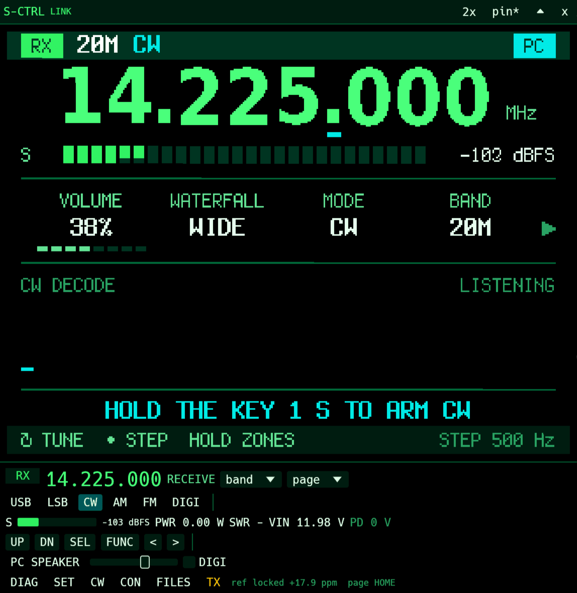
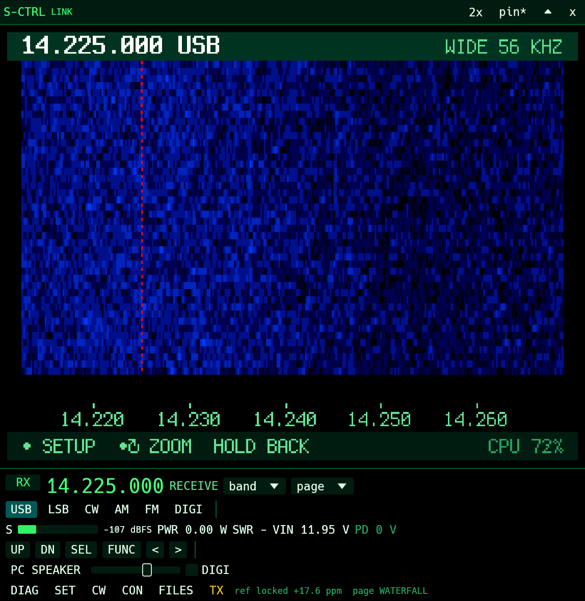
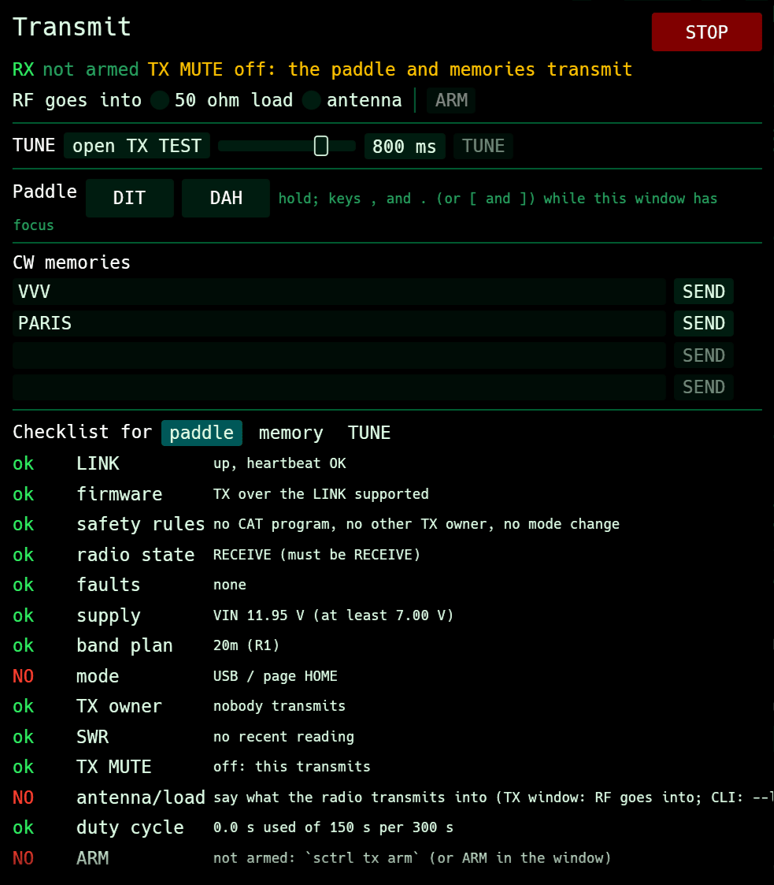
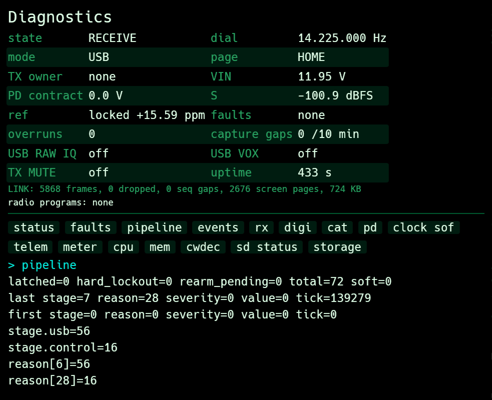

<p align="center">
  
</p>

<h1 align="center">S-CTRL</h1>

<p align="center">
  Desktop control for the SPARTACUS REV1 transceiver on Linux:<br>
  its live screen, its panel, a PC speaker and safeguarded TX, over one USB cable.
</p>

<p align="center">
  <a href="LICENSE"></a>
  
  
</p>

<p align="center">
  
  &nbsp;
  
</p>

S-CTRL finds the radio on USB by itself and puts its screen on your desktop, live, in a small
floating window. You turn the knob, press its buttons, change band, mode and frequency from
the PC, hear the radio on the PC's speakers, and key it behind a checklist that refuses
anything unsafe. Everything the window does, `sctrl` does from a shell, for scripts and
agents.

## Features

- **A live mirror of the radio's screen.** Every page, the waterfall, SPLIT and SPECTRUM
  included, drawn from what the radio sends: only the strips that changed. The ▲ arrow rolls
  the window up to its title bar and back.
- **The panel and the main controls:** knob, UP/DN/SEL/FUNC, band, mode, frequency, and a
  page menu (home, frequency, diagnostics, TX TEST, CW trainer, SD, PD, waterfall). Esc backs
  out of the radio's menus, as FUNC does.
- **PC speaker:** the radio's audio, sidetone and CW trainer on the PC's output (DIGI only
  when asked). Low latency for CW, on by default and remembered. It plays next to the PC's
  other audio and never routes anything into the radio's TX input.
- **Companion windows:** diagnostics, settings, the CW decoder and memories, the radio's
  console, the SD card (read only: browse, view, save a copy) and TX.
- **TX with safeguards:** TUNE, the paddle and CW memories behind ARM, a pre-TX checklist
  (supply, band plan, SWR, faults, other programs), time and duty-cycle limits, a load
  declaration and an audit log. STOP is never refused. Never keys next to WSJT-X & co.
- **`sctrl`, a CLI for scripts and agents** (see [AGENTS.md](AGENTS.md)): with the window
  open, commands share its connection; without it they open the radio themselves.
  `--port` names the LINK port instead: a pseudo-terminal, such as an emulated radio's.

S-CTRL never opens the radio's CAT port (WSJT-X's); it talks over its own LINK port. Other
radios on ST's USB ID (QRP Labs QMX, QMX+, QDX ...) are listed and never touched.

<table>
  <tr>
    <td width="50%" valign="top">
      
      <p><b>TX.</b> Nothing keys until every checklist item passes. Here the paddle would be
      refused three times: the radio is in USB (the paddle needs CW or the TX TEST page), no
      load has been declared, and it is not armed. Each item says how to fix it.</p>
    </td>
    <td width="50%" valign="top">
      
      <p><b>Diagnostics.</b> The radio's state from its 10 Hz STATUS, the LINK's counters
      (frames, drops, sequence gaps) and the radio's diagnostic console commands, one click
      each.</p>
    </td>
  </tr>
</table>

## Requirements

- A SPARTACUS REV1 on alt2 firmware with the LINK (v8.11 or later) and its USB personality
  on audio. A radio in DIAG (the console) stays there until you say: the window offers a
  button, or `sctrl usb audio`. Without the LINK, the CLI falls back to the console.
- Linux with PipeWire. S-CTRL runs PipeWire's own tools (`pw-dump`, `pw-loopback`,
  `wpctl`), which come with it, and `systemd-inhibit` where present (the PC stays awake
  while TX is armed).
- Access to the radio's serial ports, as for any USB radio (usually the `uucp` or `dialout`
  group). Nothing else to install or configure: no udev or WirePlumber rules.

## Build and install

Only a Rust toolchain (current stable; egui needs 1.95 or later):

```sh
cargo build --release
./target/release/sctrl          # the window
./target/release/sctrl --help   # the CLI
```

To have it in rofi (`-show drun`) and application menus, `scripts/install.sh` builds the
release and installs it for your user only: `~/.local/bin/sctrl`, a desktop entry in
`~/.local/share/applications` and its icon. `scripts/install.sh --uninstall` removes them.
Launching it again while it runs brings the window forward, unshaded (`sctrl show`).

Settings live in `~/.config/sctrl/config.json` (PC speaker, TX limits, window, CW memories);
the TX audit log in `~/.local/state/sctrl/tx.log`.

## From a shell

```console
$ sctrl status
SPARTACUS REV1 1A2B3C4D5E6F  firmware v8.11  LINK v1
RECEIVE    14.225.000 Hz  USB  page HOME
VIN 11.97 V   PD 0.0 V   S -107.5 dBFS   ref locked +17.79 ppm
TX: owner none  CAT PTT off  TX MUTE off  armed off  USB VOX off  USB RAW IQ off
faults none  lockout off  overruns 0  capture gaps 0/10 min
CAT port 0 (WSJT-X's): closed; last command never
host: no radio programs running
$ sctrl tune 7074k && sctrl mode cw && sctrl goto waterfall
$ sctrl shot -o screen.png
```

Every command takes `--json` and exits with a code that says what happened (refused by a
safety rule, timeout, no radio ...). [AGENTS.md](AGENTS.md) has the full list, the recipes and
the rules S-CTRL enforces.

## How it works

### One cable, one composite USB device

The radio is a USB full-speed device: 12 Mbit/s, with the bus split into 1 ms frames. In its
AUDIO personality it shows the PC three functions at once:

| Interfaces | Function | Endpoints | Every 1 ms frame |
|---|---|---|---|
| 0-2 | Sound card (USB Audio Class 1), 48 kHz, 16-bit stereo | isochronous IN (receive audio to the PC), isochronous OUT (TX audio from the PC), 3-byte rate feedback | 192 B each way (48 stereo samples) |
| 3-4 | Serial port 0: CAT, for WSJT-X, hamlib & co. | bulk IN 32 B, OUT 8 B | what the program asks |
| 5-6 | Serial port 1: the LINK, for S-CTRL | bulk IN 32 B, OUT 8 B | at most 2 IN packets: 64 B, so 64 KB/s |

Every frame starts with a start-of-frame (SOF) token from the PC. The audio endpoints are
isochronous: their bandwidth is reserved in every frame, so sound never waits for anything
else on the cable. The serial ports are bulk: they use what is left. A busy second looks
like this:

| Stream | Direction | Per second |
|---|---|---|
| Receive audio | radio → PC | 192,000 B |
| TX audio (only while something plays into the radio) | PC → radio | 192,000 B |
| LINK: screen, waterfall, status, replies | radio → PC | about 3,400 B (measured), at most 64,000 B |
| LINK: heartbeat, knob, buttons, paddle, commands | PC → radio | tens of bytes |
| CAT | both | a few hundred bytes from WSJT-X |

That is about a quarter of what full speed carries (about 1.5 MB/s), so nothing has to
share a frame tightly. The SOF also serves as a clock: the radio time-stamps it to keep its
own reference locked to the PC's USB clock (`ref locked` in the window).

### Inside the radio: audio first, the LINK last

- **Audio** moves between the DSP and USB packet memory in interrupts with double buffers.
  The rate feedback keeps the PC's playback in step with the radio's 48 kHz. Nothing on
  the LINK can delay it.
- **The LINK** is one 256-byte ring that the main loop fills with frames when it has time.
  The SOF interrupt sends at most 2 packets of 32 B per frame and stops about 600 µs into it,
  so the USB interrupts stay few and clear of the next SOF.
- **Order within the LINK:** acknowledgements and TX events, then STATUS, CAT replies,
  console output, CW decoder text, SPECTRUM, and last the screen. A safety message never
  waits behind a screen page.
- **While the radio is realtime-critical** (keyed CW, TX audio streaming), only STATUS,
  acknowledgements and TX events go out. The screen freezes, as the panel does.

Frames are SLIP-framed with a CRC-16 and a sequence number, so S-CTRL notices a lost frame;
the radio does not resend. The protocol is in [docs/link-protocol.md](docs/link-protocol.md).

### The screen: only what changed

The 320×240 display lives in the radio as 1 bit per pixel plus one colour byte (foreground
and background from 16 colours) for each 8×8 tile: 10,800 B. It is sent as 30 *pages* of 8
rows, 360 B each. The firmware already knows which pages its last drawing changed. Every 4 ms
the LINK takes one changed page, compresses it (PackBits run-length, typically to about
200 B) and sends it. A page that changes again before it leaves goes once, with its newest
content. S-CTRL decodes it into the same layout and redraws only that strip of the window.

The waterfall is the exception. Redrawing its pages for every new line would swamp the
LINK, so the radio marks those pages as the *band* and sends them without data. For each new
line it sends one SPECTRUM frame instead: the frequency axis, the colour scale and 304
pixels of 4-bit levels (152 B), plus the spectrum trace and peak hold when shown. S-CTRL
keeps the history and draws the band as the radio does, with the same palettes and
layouts (WATERFALL, SPLIT, SPECTRUM).

On the bench (2026-10-06): the HOME page sends about 14 pages a second; the WATERFALL page
about 9 lines and 6 pages a second; about 24 frames and 3.4 KB per second in both cases.
That costs the radio's processor about 1.2 % on HOME and 0.6 % on WATERFALL. While S-CTRL's
window is shaded, minimised or hidden, it stops asking for the screen and the spectrum; then
only the 10 Hz STATUS frames travel.

### Status and control

- **STATUS** (48 B, 10 times a second): frequency, mode, page, radio state, TX owner,
  faults, supply, power, SWR, level, reference lock, ARM time left. The window's text and
  the CLI's `status` come from it.
- **From the PC**, small frames that fit one 8-byte packet: knob and button presses, page
  changes, the paddle (repeated every 100 ms while held), and a heartbeat every 250-500 ms.
  Without a heartbeat for 1.5 s the radio releases everything S-CTRL keyed and disarms.
- Frequency and mode go as CAT commands tunnelled through the LINK; settings and
  diagnostics as console commands. S-CTRL never touches serial port 0, so WSJT-X keeps it.

### The PC speaker

S-CTRL starts PipeWire's `pw-loopback` from the radio's capture (the receive audio arriving
over USB) to the PC's output, with a 128-sample buffer (2.7 ms) for CW and the trainer and
512 otherwise. While it is the radio's only recorder, it asks the radio for its headphone
mix in place of the plain receive audio, so the PC also hears the sidetone and the CW
trainer. In DIGI the capture stays untouched for WSJT-X and the PC speaker is off unless
asked. Nothing is ever played into the radio's own sink: in this personality that is the
transmitter's audio input.

## Repository layout

| Path | What |
|---|---|
| `crates/proto` | LINK codec: SLIP, CRC, frames, screen/spectrum decoding. No I/O. |
| `crates/core` | Engine: discovery, LINK session, safety arbiter, TX controller, PipeWire, SD card, local socket. |
| `crates/sctrl` | The `sctrl` binary: the window (no arguments), `sctrl daemon`, CLI commands. |
| `docs/link-protocol.md` | The USB LINK protocol, identical to the firmware's copy. |
| `scripts/check.sh` | fmt, clippy and tests: run before committing. |
| `scripts/install.sh` | The release for this user: binary, desktop entry, icon (`--uninstall`). |
| `packaging` | The desktop entry and the icon (SVG; the PNG is the window's own). |
| `tests/fixtures` | LINK test vectors shared with the firmware. |
| `CONTRIBUTING.md` | How to work on S-CTRL: checks, commits, radio safety. |
| `LICENSE` | The GNU General Public License, version 3. |

## License

GNU General Public License v3.0 or later — see `LICENSE`. Copyright (c) 2026 Cem ASLAN.

S-CTRL keys a transmitter. Transmitting needs an amateur radio licence, and what goes on air
is the operator's responsibility. The TX safeguards are there to help, not a guarantee: like
the rest of S-CTRL, they come without any warranty (sections 15 and 16 of the license).
